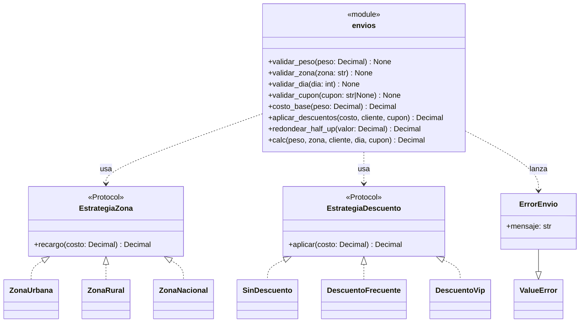

# 06 · Refactorización (v1.0.0 → v2.0.0)

Rama: `refactor/estrategia`. Integrada a `main` con `--no-ff`.

Objetivo: eliminar la deuda técnica del heredado **sin cambiar el comportamiento
observable** (los 43 casos de prueba siguen en verde) y dejar el código preparado
para el cambio `CAMBIO=1` de la Parte 8.

## 1. Malos olores detectados

| # | Mal olor (nombre técnico) | Ubicación en v1.0.0 | Deuda técnica | Refactor aplicado |
|---|---------------------------|---------------------|---------------|-------------------|
| 1 | Números mágicos (*Magic Numbers*) | `envios.py:16,18,20,24,26,29,31,33,36,38,41` (`6000`, `9000`, `800`, `5000`, `100`, `0.05`, `0.10`) | Cambiar un parámetro exige buscar literales; riesgo de inconsistencia | Constantes nombradas `TARIFA_TRAMO1`, `TARIFA_TRAMO2`, `TARIFA_KG_ADICIONAL`, `MINIMO`, `PASO_REDONDEO`, `DESC_FRECUENTE`, `DESC_CUPON` |
| 2 | Nombres crípticos (*Poor Naming*) | `envios.py:12` (`p, z, c, d, cup, t`) | Difícil de leer y de mantener | `peso, zona, cliente, dia, cupon, costo` |
| 3 | Argumento bandera (*Flag Argument*) | `envios.py:12,39-40` (`flag`) | La función tiene dos responsabilidades (calcular e imprimir) | Se elimina `flag`; `calc` no imprime. El `print` pasa al llamador |
| 4 | Código muerto / sentencia inútil (*Dead Code*) | `envios.py:22` (`t = t`) | Confunde: sugiere una lógica que no existe | Se elimina; `ZonaUrbana.recargo` devuelve el costo sin cambios |
| 5 | Comparación con `None` (*None Comparison*) | `envios.py:34` (`cup != None`) | Estilo incorrecto; puede invocar `__eq__` sobrecargado | `cupon is not None` |
| 6 | Cadena de `if/elif` (*Switch Statements*) | `envios.py:21-26,30-36` | Agregar una zona o descuento obliga a editar `calc` (viola OCP) | Patrón **Strategy** con `EstrategiaZona` y `EstrategiaDescuento` |
| 7 | Función larga / Dios (*Long Method*) | `envios.py:12-41` | Valida, calcula, descuenta, redondea e imprime: baja cohesión | Se divide en 7 funciones + 2 jerarquías de estrategias |
| 8 | E/S mezclada con lógica (*I/O in Domain Logic*) | `envios.py:40` (`print`) | Efecto secundario oculto; difícil de testear | `calc` es pura; la impresión es responsabilidad del cliente |
| 9 | Estado global mutable (*Global Mutable State*) | `envios.py:3-10` (`CONFIG`) | Acoplamiento oculto; los tests no pueden aislar configuración | Constantes inmutables a nivel de módulo y parámetros explícitos |
| 10 | Duplicación de fórmula (*Duplicated Code*) | `envios.py:24,26,31,33,36` (`t = t ± t * x`) | La misma fórmula repetida cinco veces | Helper `aplicar_tasa` + estrategias |
| 11 | Falta de tipos y documentación | Todo el archivo | API ambigua; sin contrato explícito | *Type hints* y *docstrings* en todas las funciones públicas |
| 12 | Redondeo por truncamiento | `envios.py:41` (`int(t/100)*100`) | Trunca en vez de redondear; error de negocio (DEF-06) | `redondear_half_up` con `Decimal` y `ROUND_HALF_UP` |
| 13 | Error genérico y mensaje ambiguo | `envios.py:14` | No distingue peso/zona/día/cupón | `ErrorEnvio(ValueError)` con mensaje específico por validación |

## 2. Clasificación de los cambios

| Cambio | Tipo | Justificación |
|--------|------|---------------|
| Corrección DEF-01…DEF-07 | **Correctivo** | Elimina fallos respecto a la especificación |
| Extracción de funciones y estrategias | **Perfectivo** | Mejora estructura y legibilidad sin alterar el contrato |
| Constantes, *type hints*, *docstrings* | **Perfectivo** | Mantenibilidad y comprensión |
| `Decimal` + `ROUND_HALF_UP` | **Preventivo** | Evita errores de coma flotante y de redondeo futuros |
| Validaciones tempranas y `ErrorEnvio` | **Preventivo** | Falla rápido y con mensaje claro |
| Nueva regla `CAMBIO=1` (Parte 8) | **Adaptativo** | Cambio solicitado por el cliente (cliente empresarial) |
| Suite de 43 pruebas y regresiones | **Preventivo** | Evita reaparición de defectos |

## 3. Diagrama de clases UML



> La versión PNG se genera con `docs/uml_clases.py` en
> `evidence/uml_clases.png`.

## 4. Tabla antes / después

| Métrica | v1.0.0 | v2.0.0 | Variación |
|---------|--------|--------|-----------|
| Complejidad ciclomática máxima por bloque | **15** (`calc`, `radon`) | **3** (`calc`, `costo_base`, `validar_dia`, `validar_cupon`) | −80 % |
| Complejidad promedio por bloque | **15,0** (1 bloque) | **1,76** (25 bloques) | −88 % |
| Bloques (funciones/clases/métodos) | 1 | 25 | +24 |
| SLOC (sin blancos ni comentarios) | 37 | 129 | +92 |
| Líneas físicas | 41 | 197 | +156 |
| Cobertura de sentencias | 96 % | **100 %** | +4 pp |
| Cobertura de ramas | — (no medida) | **100 %** | — |
| Pruebas | 36 (14 pasan) | **43 (43 pasan)** | +7, 100 % |
| Variables globales mutables | `CONFIG` (7 claves) | 0 | −7 |
| Efectos secundarios en el cálculo | `print` | ninguno | eliminado |
| API pública | `calc(p,z,c,d,cup,flag)` | `calc(peso,zona,cliente,dia,cupon)` | sin `flag` |
| Error lanzado | `ValueError` genérico | `ErrorEnvio` (subclase de `ValueError`) | específico |

El SLOC sube porque el diseño explícito (constantes, estrategias, tipos y
docstrings) cuesta líneas, pero **cada bloque es mucho más simple**: el máximo
baja de 15 a 3 y el promedio de 15,0 a 1,76. La deuda se paga en volumen, no en
complejidad.

## 5. Verificación

```powershell
python -m radon cc envios.py -s -a
python -m pytest -q --cov=envios --cov-branch --cov-report=term-missing
```

Resultados obtenidos:

- `radon`: 25 bloques, complejidad promedio **A (1,76)**, máximo **3**.
- `pytest`: **43 passed**.
- `coverage`: **100 %** de sentencias y **100 %** de ramas.

## 6. Commits de la rama

| Commit | Contenido |
|--------|-----------|
| `refactor: extrae funciones, aplica estrategia y usa Decimal en todo` | Reescritura de `envios.py` a v2.0.0 |
| `merge: integra refactor/estrategia (v2.0.0)` | Integración `--no-ff` a `main` |

La rama conserva la historia completa de los siete `fix/DEF-0x` que la preceden.
